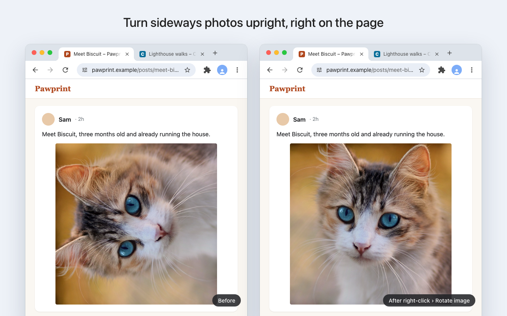

# Upright – Rotate Images & Videos

Turn sideways photos and phone videos upright, right on the page. Right-click → **Rotate image**,
or hover and press **Alt+Shift+R**. The page doesn’t jump: the picture turns in its own space.



## What it does

- **Right-click menu:** “Rotate image” / “Rotate video”, a quarter turn per click. Or switch to the
  full menu: clockwise, counterclockwise, 180°, flip horizontally, flip vertically, reset, and open
  in a new tab.
- **Shortcuts** for whatever is under the pointer (change them at `chrome://extensions/shortcuts`):
  - **Alt+Shift+R**: rotate clockwise
  - **Alt+Shift+L**: rotate counterclockwise
  - **Alt+Shift+0**: reset
  - **Alt+Shift+V**: open it in the viewer
- **Single-key mode** (off by default): hover and press **R**, **L** or **0**, on all sites or only the
  ones you choose. Never while you’re typing.
- **Viewer:** a full-window view with rotate, flip and zoom, and “Save rotated copy” where the site
  allows it.

It works on images, `<picture>` elements and videos, including responsive images served in several
sizes. It can’t turn CSS background images, canvas drawings, or media inside frames from another
site.

## Privacy

Nothing is collected or sent anywhere: no requests of its own, no analytics, no account. See
[PRIVACY.md](PRIVACY.md).

## Permissions

| Permission | Why |
|---|---|
| `activeTab`, `scripting` | Turning the image you right-clicked or pointed at, on that page, at that moment |
| `contextMenus` | The Rotate items on the right-click menu of images and videos |
| `storage` | Your settings (synced through Chrome Sync, like Chrome’s own) |
| `offscreen` | A tiny hidden page that tells whether Chrome is in light or dark mode, for the toolbar icon |
| Site access (optional) | Only for single-key mode, and only on the sites you choose; asked for when you turn it on |

Installing it shows no warnings. Single-key mode asks for site access when you switch it on.

## Install from source

Needs Chrome 120 or later.

1. Download or clone this repository.
2. Open `chrome://extensions`, turn on **Developer mode**, click **Load unpacked**, and choose this
   folder.

## Development

```sh
npm install          # vitest and Playwright
npm test             # unit tests
npm run test:e2e     # browser tests in Playwright's Chromium
npm run package      # tests, then release/upright-<version>.zip for the Chrome Web Store
```

How it works inside (finding the right image, composing with the page’s own styles, the viewer,
wording rules) is in [DEVELOPMENT.md](DEVELOPMENT.md). Store listing text and screenshots:
`CHROMEWEBSTORE.md` and `store/`.

## License

[MIT](LICENSE) © 2026 David Sherlock / ArrayPress Limited
